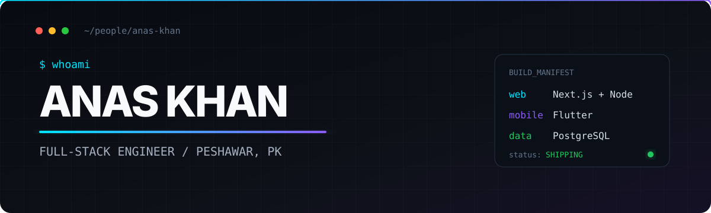

<div align="center">



<br />

<a href="https://devscript-exe.anaskhandev728.workers.dev"></a>
<a href="https://www.linkedin.com/in/anas-khan-7014b536a"></a>
<a href="https://www.instagram.com/thedevscript"></a>

</div>

## I build software for the real world.

I’m a full-stack engineer from Peshawar, Pakistan. I turn messy, practical problems into focused web and mobile products—especially in **civic tech, safety, and operations**.

```text
CURRENT SIGNAL
├─ building  → full-stack products with Next.js, Node.js & PostgreSQL
├─ exploring → AI-assisted workflows and civic technology
├─ shipping  → mobile experiences with Flutter
└─ studying  → BS Computer Science @ FAST NUCES
```

## Selected systems

| Project | What it solves | Built with |
|:--|:--|:--|
| **[AquaSentinel](https://github.com/Anas-Khannn/gdg_buildathon_hackhathon)** | AI-assisted flood intelligence, simulation, hazard routing, and civic reporting for Peshawar | Gemini · GIS · Leaflet · Hydrological simulation |
| **[SheShield](https://github.com/Anas-Khannn/she-shield-mobile-app)** | Personal safety through SOS alerts, live location sharing, emergency contacts, and secure authentication | Flutter · Node.js · Supabase |
| **[SplitEase](https://github.com/Anas-Khannn/SplitEase-expense-tracker)** | Makes shared expenses understandable and keeps group balances accountable | Next.js · Express · PostgreSQL · TanStack Query |
| **[Order & Inventory](https://github.com/Anas-Khannn/order-inventory-management-system)** | Keeps products, stock, customer orders, and business rules in one reliable workflow | TypeScript · Node.js · PostgreSQL |
| **[AI + Mobile Workshop](https://github.com/Anas-Khannn/ai-mobile-development-workshop)** | Practical demos and resources for using AI to accelerate mobile development | AI workflows · Mobile engineering · Education |

## The toolbox

<div align="center">


</div>

I care more about the system than the logo on the tool: clear domain models, deliberate interfaces, secure boundaries, and software that is understandable after the demo ends.

## Build notes

- **Start with the problem.** Features earn their place by removing friction for a real person.
- **Own the whole path.** Interface, API, data model, deployment, and the awkward edge cases between them.
- **Leave a trail.** Useful documentation and clean commits are part of the product.

<details>
<summary><b>GitHub activity</b></summary>
<br />
<div align="center">
  
  
</div>
</details>

---

<div align="center">

### Have a useful problem worth solving?

**[See what I build](https://devscript-exe.anaskhandev728.workers.dev)** · **[Start a conversation](https://www.linkedin.com/in/anas-khan-7014b536a)** · **[Browse every repository](https://github.com/Anas-Khannn?tab=repositories)**

<sub>Peshawar, Pakistan · open to product collaborations and open-source work</sub>

</div>
